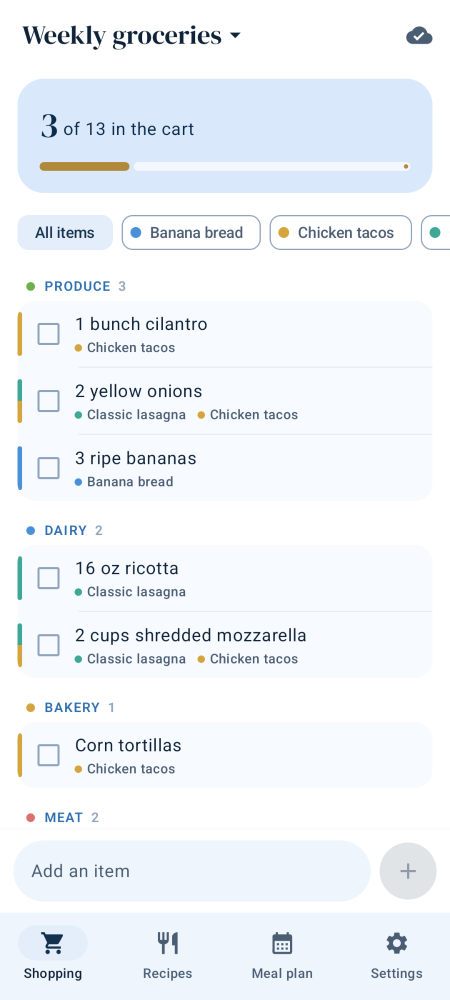
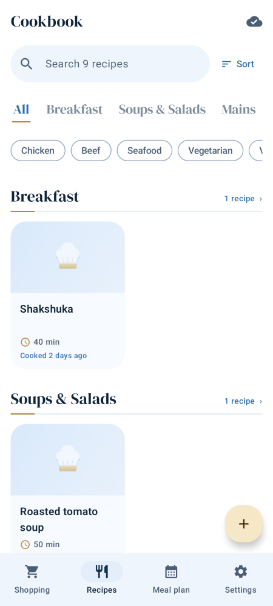
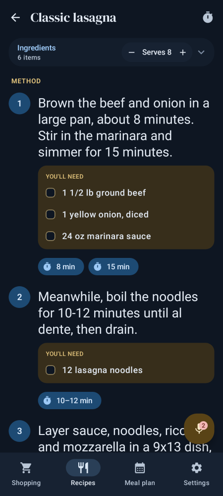
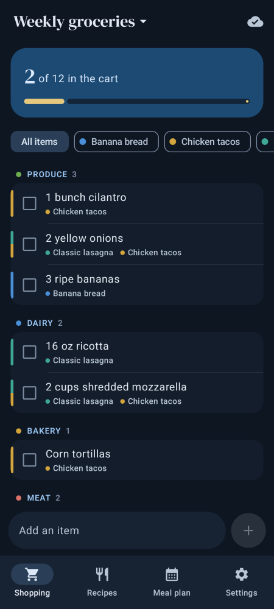
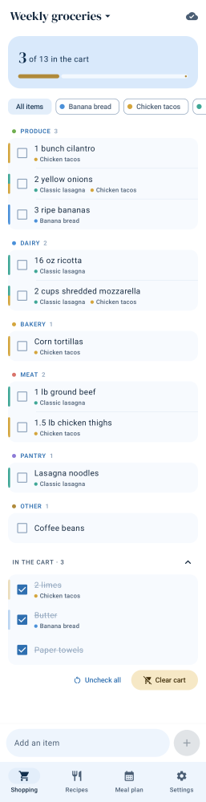
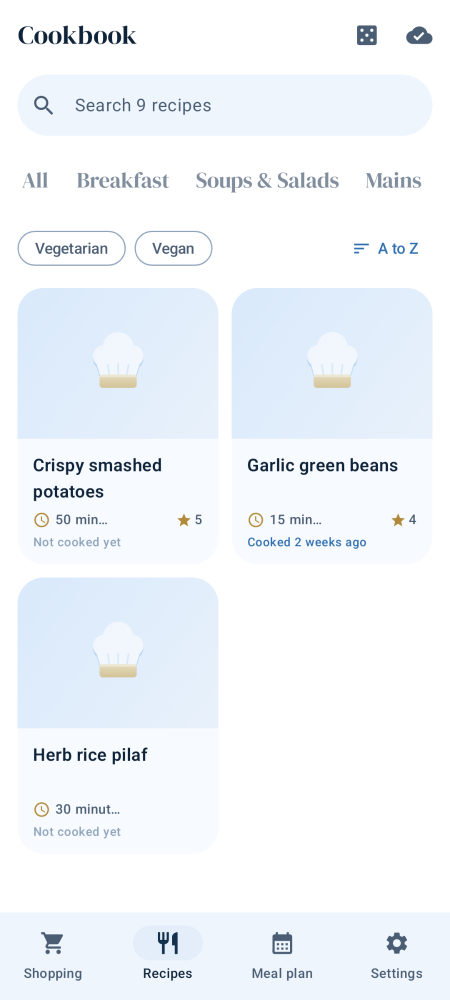
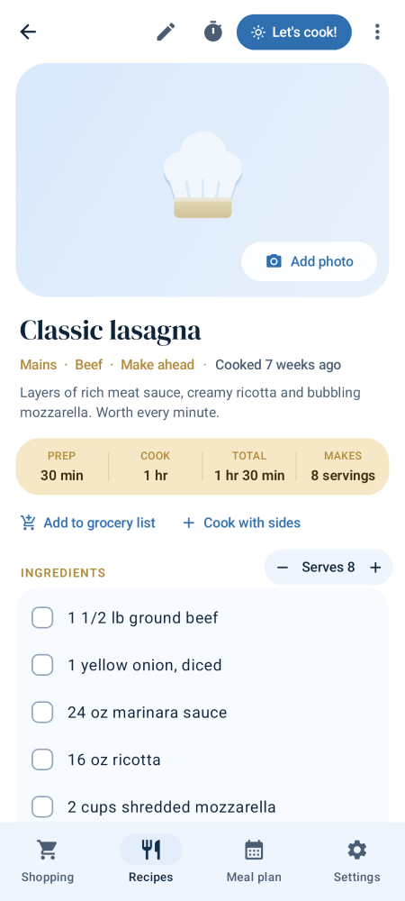
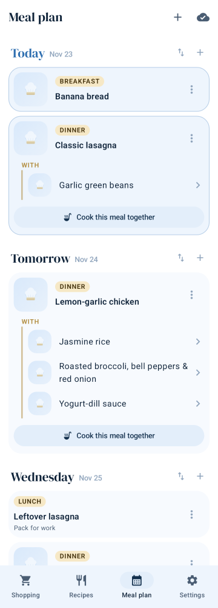
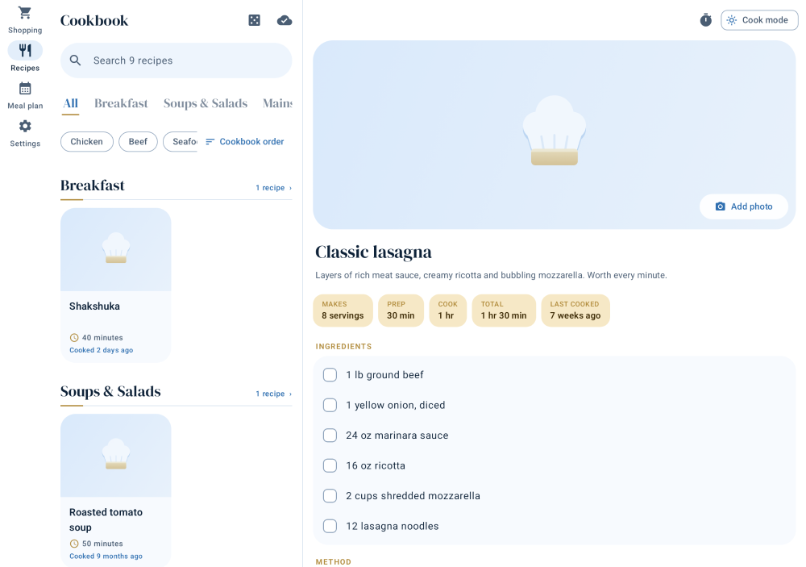

<p align="center">
  
</p>

# YesChef

YesChef is a native Android app for [Mealie](https://mealie.io), the self-hosted recipe manager. It
gives you your recipes, meal plan and shopping lists on an Android phone or tablet, and keeps working
in the store or kitchen when you have no signal. Mealie stays the source of truth; YesChef caches
everything locally and syncs edits back when it can reach your server.

It's free, open source (MIT) and has no accounts, ads, tracking or subscription. It talks only to
your own Mealie server.

<p align="center">
  
  
  
  
</p>

## Features

- **Shopping lists sorted by aisle.** Items are grouped into store sections from Mealie's labels,
  in the order you set in Mealie. Each item gets a colour stripe and tag for the recipe it came
  from, and you can filter the list to one recipe. Tick items or add new ones offline.
- **Multiple lists.** Switch, create, rename and delete lists. **Clear cart** removes everything
  you've ticked, and **Uncheck all** starts the list over.
- **Shopping Day.** Shop from several lists at once, say Weekly meals plus a small Household list
  for toilet paper and dish soap. Tap **Shopping Day** on the shopping screen and pick the lists
  (YesChef remembers them). You get one list sorted by store section, each item tagged with the
  list it's on. Ticking an item updates its own list, and the add bar lets you pick which list a
  new item goes on.
- **Cookbook.** Recipes read like a cookbook, with chapters from Mealie categories and filter chips
  from tags (see [the cookbook scheme](#the-cookbook-categories-and-tags)). Sort by name, newest, rating,
  quickest or "not made in a while", or let the dice pick something.
- **Cook mode.** Large text, screen stays awake, and each step shows the ingredients it needs
  ("You'll need"). When you finish, YesChef offers to mark the recipe as cooked.
- **Cooking notes.** Tap the mic in cook mode and say what happened ("needed 10 more minutes").
  Notes are tagged with the step on screen and saved to the recipe's timeline in Mealie, ready for
  an assistant to review.
- **Timers.** Times in the steps ("bake 25 minutes", "10-12 min") become chips you tap to start a
  timer, labelled with the step and recipe. Run several at once from the tray or the notification.
  A finished timer rings with your alarm sound, even when the app is closed.
- **Servings scaler.** Scales every amount, including ones Mealie hasn't parsed.
- **Nutrition.** Mealie's per-serving values, in a section that expands when tapped.
- **Recipe photos.** Take one with the camera or pick one from the gallery.
- **Edit recipes by hand.** Change the name, description, servings, prep/cook/total times,
  ingredients (add, remove, reorder, one per line, amount first) and steps. Works offline; Mealie
  re-reads new and changed ingredient lines when the edit syncs, so they still scale and go on the
  shopping list properly. Leave a time blank if you don't know it; cook time 0 means no cooking.
- **Add any recipe to any grocery list.** Pick the list (or make a new one), choose the servings and
  untick what you already have. Works offline; Mealie scales and merges the lines on the next sync.
- **Meal plan.** The next three weeks; planned recipes are downloaded ahead so they open offline.
- **Phone and tablet.** On a tablet the recipe opens beside the list.
- **Light, dark or system theme.**

## Screenshots

| Shopping | Cart | Cookbook | Sides chapter |
| --- | --- | --- | --- |
|  |  |  |  |
| **Recipe** | **Cook mode** | **Meal plan** | **Dark theme** |
|  |  |  |  |

On a tablet:



These are rendered from the app's code by the screenshot tests, so they always match the current
version. Sample recipes are made up.

## What you need

- **A Mealie server** (Mealie v3; developed against v3.31). Any Mealie install works. If you run a
  [Start9](https://start9.com) server, [mealie-startos](https://github.com/homebrew-gh/mealie-startos)
  packages Mealie for StartOS 0.4 and adds an optional AI connector for Claude and other assistants.
- **An Android phone or tablet** running Android 10 or newer.
- **A way to reach the server from your phone**: your home network, or a VPN such as WireGuard when
  you're out (see [Reaching your server](#reaching-your-server)).

## Install

YesChef isn't on Google Play. Install the APK directly:

1. On your phone or tablet, open the [latest release](https://github.com/homebrew-gh/yeschef/releases/latest)
   and download `yeschef-<version>.apk`.
2. Open it. Android asks you to allow installs from your browser or file manager the first time.
3. To update, install a newer APK the same way. It replaces the app in place and keeps your data,
   because every release is signed with the same key.

You can also let [Obtainium](https://obtainium.imranr.dev) keep it up to date: add
`https://github.com/homebrew-gh/yeschef` as an app.

YesChef is also listed on [Zapstore](https://zapstore.dev), which installs and updates it for you.

## First run

1. In Mealie, open your profile, go to **API Tokens**, create a token and copy it.
2. In YesChef, enter your server address, for example `https://mealie.example.com` or
   `http://192.168.1.20:9000`. YesChef adds `/api` itself.
3. Paste the token and tap **Connect**. You can also sign in with your Mealie username and password
   instead; YesChef exchanges them for a token and doesn't store the password.

You can change the server, token and theme later in **Settings**.

## Reaching your server

YesChef needs to reach Mealie whenever it syncs, but works offline in between. At home your Wi-Fi is
enough. Away from home, the simplest safe option is a VPN to your home network, so Mealie never has
to be exposed to the internet:

- **WireGuard** (or Tailscale, or your router's VPN): turn it on and use the address you'd use at
  home. YesChef syncs automatically as soon as a VPN connects.
- **Start9**: StartOS has WireGuard built in. Connect it, then use one of the addresses StartOS lists
  for Mealie's **Web UI and API** interface.

### HTTPS with your own certificate (Start9 and self-signed)

Android apps don't trust certificate authorities you install yourself unless they opt in. YesChef
opts in, so you only need to install your CA on the device once:

1. Get the CA certificate. On Start9, download your server's **Root CA** from StartOS (see Start9's
   guide to trusting your Root CA). For your own setup, use the CA that signed Mealie's certificate.
2. On Android: **Settings > Security & privacy > More security settings > Encryption & credentials >
   Install a certificate > CA certificate**, then pick the file. (Menu names vary a little by phone.)

A certificate that is self-signed but not a CA can't be installed this way; put it behind a CA, or
use plain `http://` inside the VPN. YesChef allows plain HTTP because the VPN already encrypts the
traffic, but your token travels unencrypted if you use HTTP without a VPN.

## The cookbook: categories and tags

The Recipes tab reads like a cookbook. Its chapters come from Mealie **categories**, and its filter chips come from **tags**. Give each recipe one category and as many tags as fit. This scheme is what the app expects:

| Mealie field | Use it for | Values |
| --- | --- | --- |
| Category (one per recipe) | Chapter | Mains, Sides, Soups & Salads, Breakfast, Desserts, Baking, Starters & Snacks, Drinks, Sauces & Basics |
| Tags: protein | Filter chips | Chicken, Beef, Pork, Lamb, Turkey, Seafood, Vegetarian, Vegan |
| Tags: style | Search and future filters | Quick (under 30 min), Slow cooker, Grill, One pot, Make ahead, Weeknight, Freezer friendly |

Common alternatives are understood too. "Main course", "Dinner" and "Entree" go under Mains, and "Side dish" goes under Sides. "Fish" and "Shrimp" count as Seafood. Any other category becomes a chapter of its own, after the standard ones. Recipes with no category go under "More recipes".

**Last cooked** is Mealie's "last made" date. When you leave cook mode the app asks "Mark as cooked?", and the date then shows on the recipe card. Sort by "Not made in a while" to find old favourites. The dice button picks a random recipe from what's on screen and skips anything cooked in the last two weeks.

### Letting an AI assistant organise your library

Tagging a big library by hand is tedious, so let an assistant do it. With
[mealie-startos](https://github.com/homebrew-gh/mealie-startos), turn on its AI connector and add it
to Claude (or another assistant that supports MCP connectors). The connector's recipe tools already
describe this scheme, so you can just ask "sort all my recipes into chapters and tag them by
protein", or "I made the chili last night" to set its last-cooked date. With other setups, paste the
table above into your assistant's instructions and give it access to Mealie's API.

## Cooking notes

In cook mode, the mic button takes a quick spoken note with Android's own speech recognizer (on the phone, offline when your phone supports it; no server model needed). Each note records the time and the step on screen. If the phone has no speech recognizer, the button opens a box to type in instead.

Notes stay on the phone, even if the app is closed, until you leave cook mode. Then YesChef shows them so you can fix, delete or add to them, and **Save to Mealie** adds them to the recipe's timeline as one "Cook notes" entry (and, if ticked, marks the recipe as cooked). Like other edits, this works offline and goes with the next sync. **Keep for later** leaves them on the phone, and the recipe page shows a button to save them.

With the [mealie-startos](https://github.com/homebrew-gh/mealie-startos) AI connector, ask your assistant something like "review today's cooking notes and suggest fixes": its `list_cook_notes` tool reads them, and it can update the recipe once you agree.

## Scaling and nutrition

The **Serves** control next to Ingredients scales every amount, including the "You'll need" boxes in cook mode. It changes the number at the start of each ingredient line ("1 1/2 lb" becomes "2¼ lb"), so ingredients Mealie hasn't parsed scale too. Lines with no amount, like "salt to taste", are left as they are. Recipes without a serving count get a ×½ to ×4 multiplier instead. **Nutrition** shows Mealie's per-serving values in a small section that expands when tapped.

## How sync works

Mealie has no "changed since" query for lists and meal plans, so each sync pushes queued edits
first, then re-pulls recipes (summaries), shopping lists and the meal plan in full. For one
household's data this is small. A sync runs when a VPN connects, when the app comes
to the foreground, about every 30 minutes, and right after each edit (WorkManager retries with
backoff while the server is unreachable). Local edits that haven't been sent are never overwritten
by server data.

## Troubleshooting

- **Setup can't connect.** Open the same address in the phone's browser. If that fails
  too, the phone can't reach the server: check the VPN is on and the address and port are right.
  If the browser warns about the certificate, install your CA (see above).
- **Works in the browser but not in YesChef.** Check the address has no extra path (use
  `https://host`, not `https://host/g/home`), and that the API token hasn't been deleted in Mealie.
- **Shopping items aren't grouped by aisle.** Grouping uses Mealie labels on foods. Give foods a
  label in Mealie (or let an assistant do it), and set the label order in the shopping list's
  settings.
- **Recipes have no chapters.** Give them Mealie categories (see the cookbook scheme above).
- **"App not installed" when updating.** The installed copy was signed with a different key (for
  example a debug build from CI). Uninstall it once, then install the release APK.
- **Timer doesn't ring.** Allow notifications for YesChef, and on Android 12+ allow **Alarms &
  reminders** in the app's settings.
- **Edits don't show up in Mealie.** They're queued until the server is reachable. Open the app
  with the VPN on, or pull down on the shopping list to sync now.

## Contributing

YesChef is maintained as-is for one household's use. It's MIT-licensed, so you're welcome to fork
it, and pull requests are welcome too: bug fixes, new features, translations, or a version for
another platform. There's no roadmap and no promise of support, so please don't expect issues to be
worked on unless you're bringing a fix. Keep pull requests small and focused, and include a
screenshot test for UI changes (CI renders the screenshots onto the pull request).

## Development

### Building

Requires JDK 17 and the Android SDK (API 35).

```sh
./gradlew assembleDebug        # app/build/outputs/apk/debug/app-debug.apk
./gradlew testDebugUnitTest
```

Every push and pull request is built by GitHub Actions; the debug APK is attached to the run as
the `yeschef-debug-apk` artifact, so you can sideload it without a local Android setup.

### Layout

```
app/src/main/java/app/yeschef/
  data/remote/   Mealie REST API (Retrofit + kotlinx.serialization)
  data/local/    Room cache and queued edits
  data/          Repository (sync), shopping sort logic, settings
  data/sync/     WorkManager sync worker and scheduling
  ui/            Compose screens: setup, shopping, recipes, meal plan, settings
```

### Release signing key (maintainers and forks)

Run on any computer with a JDK (`keytool` also ships with Android Studio):

```sh
keytool -genkeypair -v -keystore yeschef.jks -storetype PKCS12 -alias yeschef \
  -keyalg RSA -keysize 4096 -validity 10000 -dname "CN=YesChef"
# choose a strong password when asked

base64 -w0 yeschef.jks > yeschef.jks.b64    # macOS: base64 -i yeschef.jks -o yeschef.jks.b64
```

Then in GitHub: **Settings > Secrets and variables > Actions > New repository secret**, add:

| Secret | Value |
|---|---|
| `YESCHEF_KEYSTORE_BASE64` | contents of `yeschef.jks.b64` |
| `YESCHEF_KEYSTORE_PASSWORD` | the password you chose |
| `YESCHEF_KEY_ALIAS` | `yeschef` |
| `YESCHEF_KEY_PASSWORD` | the same password (PKCS12 uses one password) |

Keep `yeschef.jks` and its password somewhere safe (a password manager), then delete the
`.b64` file. If the key is ever lost, the next build can't update the app and you'd have to
uninstall once. Without the secrets, CI still builds but signs with a throwaway key.

### Publishing to Zapstore

The listing is configured in [`zapstore.yaml`](zapstore.yaml), with the icon in `zapstore/`. See
[`zapstore/PUBLISHING.md`](zapstore/PUBLISHING.md) for the one-time setup and how each release gets
published.

## License

YesChef is released under the [MIT License](LICENSE). DM Serif Display is under the SIL Open Font
License (see `licenses/`). Mealie is a separate project by the Mealie contributors; YesChef isn't
affiliated with it.
